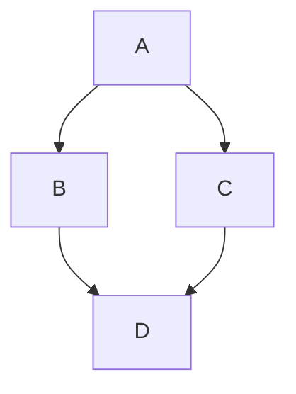

# Практическая работа №2

Вариант 11.

Визуализация графа зависимостей пакетов Maven.

## Язык реализации

Python 3.10 и новее. Для работы программы достаточно стандартной библиотеки.

## Назначение программы

Программа получает прямые зависимости пакета из POM, обходит транзитивные
зависимости и показывает результат в терминале. Для проверки обхода без
интернета есть локальные JSON-графы.

1. Конфигурация через командную строку.
2. Получение прямых зависимостей из Maven-репозитория.
3. Построение транзитивного графа рекурсивным BFS.
4. Вычисление порядка загрузки алгоритмом Кана.
5. Вывод графа в Mermaid и ASCII-дерева.

## Структура проекта

```text
.
├── src/
│   ├── main.py
│   ├── config.py
│   ├── maven.py
│   ├── graph.py
│   ├── operations.py
│   └── render.py
├── tests/
│   ├── test_cli.py
│   ├── test_config.py
│   ├── test_graph.py
│   ├── test_maven.py
│   ├── test_operations.py
│   └── test_render.py
├── test_data/
│   ├── chain.json
│   ├── cycle.json
│   ├── diamond.json
│   ├── isolated.json
│   └── self_cycle.json
├── docs/
├── scripts/
├── examples/
│   └── maven-comparison/
│       └── pom.xml
├── README.md
└── run.bat
```

## Этап 1. Конфигурация

Параметры передаются через командную строку.

| Параметр | Назначение |
| --- | --- |
| `--package` | Координаты `groupId:artifactId:version` или имя тестового пакета, например A |
| `--repository` | Адрес Maven-репозитория или путь к JSON-файлу |
| `--test-repository` | Включает локальный тестовый режим |
| `--mode` | `config`, `direct`, `graph` или `order`. По умолчанию `graph` |
| `--ascii` | Добавляет ASCII-дерево к выводу графа |
| `--help` | Показывает справку |

Имя пакета и репозиторий обязательны. Флаги `--test-repository` и
`--ascii` указываются без значения. В режиме `config` программа печатает
настройки в формате `ключ=значение`.

```bat
run.bat --package A --repository test_data/diamond.json --test-repository --mode config
```

## Этап 2. Получение прямых зависимостей

Программа строит адрес POM по координатам пакета, скачивает XML и извлекает
прямые зависимости. При разборе учитываются свойства, родительские POM,
`dependencyManagement` и импорт BOM. Maven для получения данных программой
не запускается.

```bat
run.bat --package junit:junit:4.13.2 --repository https://repo.maven.apache.org/maven2 --mode direct
```

## Этап 3. Граф зависимостей

Для транзитивного графа используется рекурсивный BFS. Каждый вызов
обрабатывает целый уровень. Найденные вершины записываются в множество,
поэтому каждая обрабатывается один раз, а рёбра к уже найденным вершинам
сохраняются. Это позволяет показать цикл без бесконечного обхода.

### Циклы

В `cycle.json` есть цепочка A → B → C → A. Обход сохраняет замыкающее
ребро и пропускает повторное посещение A.

## Тестовый режим

Имена пакетов записываются большими латинскими буквами. Ключ — имя пакета,
значение — список его прямых зависимостей.

```json
{
  "A": ["B", "C"],
  "B": ["D"],
  "C": ["D"],
  "D": []
}
```

```bat
run.bat --package A --repository test_data/diamond.json --test-repository
run.bat --package A --repository test_data/cycle.json --test-repository
```

## Этап 4. Порядок загрузки

Алгоритм Кана сначала выбирает вершины без зависимостей, затем пакеты,
у которых все зависимости уже обработаны. Для ромба получается
`D, B, C, A`. Если в графе есть цикл, программа сообщает об ошибке.

```bat
run.bat --package A --repository test_data/diamond.json --test-repository --mode order
```

```text
D
B
C
A
```

## Этап 5. Mermaid и ASCII-дерево

Программа присваивает вершинам идентификаторы и выводит рёбра в Mermaid.
Стрелка от A к B означает, что A зависит от B.



```bat
run.bat --package A --repository test_data/diamond.json --test-repository --ascii
```

После описания Mermaid выводится дерево.

```text
A
|-- B
|   `-- D
`-- C
    `-- D [shared]
```

В ASCII-дереве `[shared]` отмечает общую зависимость, уже раскрытую в другой
ветке, а `[cycle]` — возврат к вершине на текущем пути.

## Визуализация трёх пакетов Maven

### JUnit

```bat
run.bat --package junit:junit:4.13.2 --repository https://repo.maven.apache.org/maven2 --ascii
```

### Commons Text

```bat
run.bat --package org.apache.commons:commons-text:1.12.0 --repository https://repo.maven.apache.org/maven2
```

### Jackson Databind

```bat
run.bat --package com.fasterxml.jackson.core:jackson-databind:2.17.2 --repository https://repo.maven.apache.org/maven2
```

Готовые диаграммы собраны в [примерах визуализации](docs/EXAMPLES.md).

## Сравнение с Maven

Для этих трёх пакетов рёбра совпали с результатами `dependency:tree`.
Порядок из режима `order` показывает, какие зависимости должны идти раньше
родителя. Фактическая последовательность скачивания JAR у Maven может
отличаться. Команды и протоколы приведены в [отчёте сравнения](docs/COMPARISON.md).

## Ограничения

В граф включаются зависимости compile/runtime без optional. Режим
`direct` выводит все прямые зависимости. Выбор версии при конфликте,
профили Maven, exclusions, classifiers, диапазоны версий, SNAPSHOT,
relocation и дополнительные репозитории из POM не реализованы.

## Основные файлы

| Файл | Назначение |
| --- | --- |
| `main.py` | `main` выбирает режим и печатает результат |
| `config.py` | `parse_args`, `validate`, `validate_repository_url` и `coordinates` проверяют параметры. `format_config` форматирует настройки |
| `maven.py` | `read_xml` скачивает POM. `model` и `build_model` собирают и кэшируют `PomModel` |
| `maven.py` | `text` и `dependency_rows` читают XML. `interpolate` подставляет свойства, `merge_rows` объединяет данные |
| `maven.py` | `management` обрабатывает BOM, `direct` возвращает координаты зависимостей |
| `maven.py` | `managed_dependencies` индексирует управляемые зависимости, `is_runtime_dependency` проверяет включение в граф |
| `graph.py` | `TestRepository` проверяет JSON и отдаёт список зависимостей. `build_graph` и `visit_level` выполняют BFS |
| `operations.py` | `reverse_edges` строит обратные связи. `loading_order` вычисляет порядок загрузки |
| `render.py` | `mermaid` формирует описание графа. `ascii_tree` и `push_children` строят текстовое дерево |

В `scripts/` находятся команды для получения реальных примеров, запуска
сравнения с Maven и проверки сохранённых результатов.

## Запуск тестов

Из корня проекта:

```bat
python -X utf8 -m unittest discover -s tests -v
```

Через скрипт Windows можно выполнить `run.bat test`.

## Запуск через run.bat

Из корня проекта в Windows:

```bat
run.bat --package A --repository test_data/diamond.json --test-repository --ascii
```

Из PowerShell перед `run.bat` добавь `.\`. Программу можно запустить напрямую
через `python -X utf8 src/main.py` с теми же аргументами.
