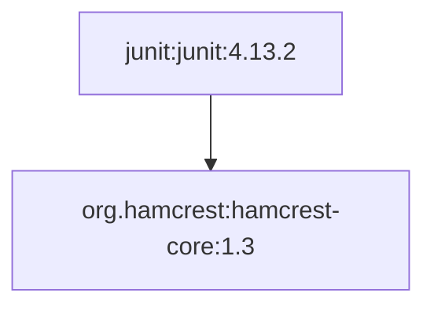
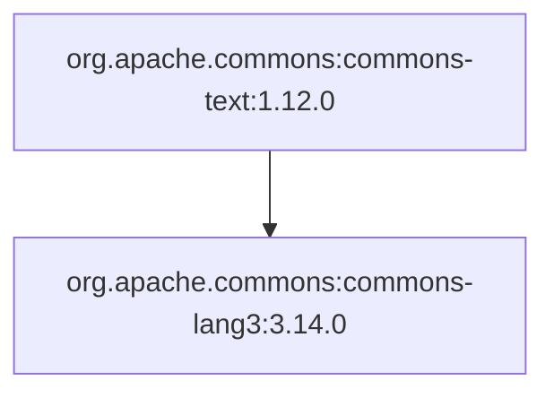
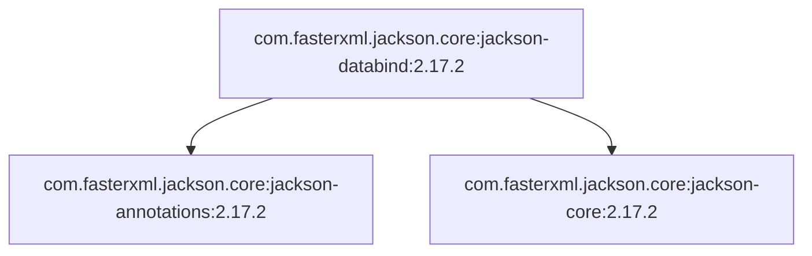

# Примеры визуализации

Получены из Maven Central для указанных версий.

## junit:junit:4.13.2



```text
junit:junit:4.13.2
`-- org.hamcrest:hamcrest-core:1.3

```

Порядок загрузки:

```text
org.hamcrest:hamcrest-core:1.3
junit:junit:4.13.2

```

## org.apache.commons:commons-text:1.12.0



```text
org.apache.commons:commons-text:1.12.0
`-- org.apache.commons:commons-lang3:3.14.0

```

Порядок загрузки:

```text
org.apache.commons:commons-lang3:3.14.0
org.apache.commons:commons-text:1.12.0

```

## com.fasterxml.jackson.core:jackson-databind:2.17.2



```text
com.fasterxml.jackson.core:jackson-databind:2.17.2
|-- com.fasterxml.jackson.core:jackson-annotations:2.17.2
`-- com.fasterxml.jackson.core:jackson-core:2.17.2

```

Порядок загрузки:

```text
com.fasterxml.jackson.core:jackson-annotations:2.17.2
com.fasterxml.jackson.core:jackson-core:2.17.2
com.fasterxml.jackson.core:jackson-databind:2.17.2

```
